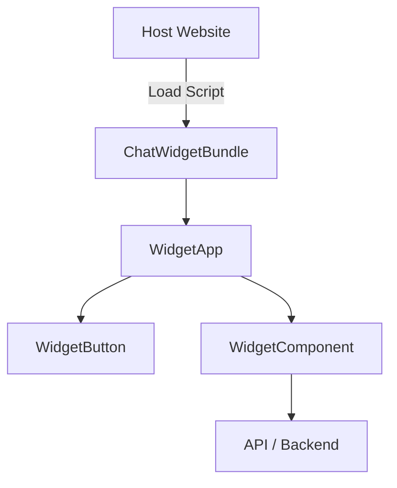
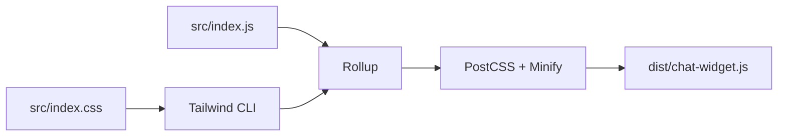
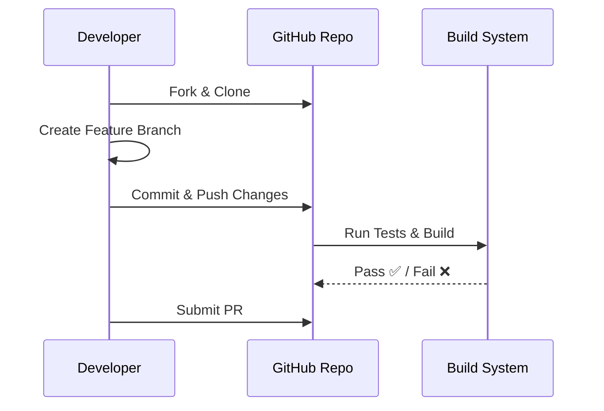

Got it ✅ — diagrams will make the README way more **visual and beginner-friendly**. Since GitHub doesn’t render Mermaid live, we’ll use **Mermaid fenced code blocks** (so people with preview support see them) and also explain them textually.

Here’s the **updated README.md with diagrams** added 👇

---

# 💬 Andromedia Chat Widget

A lightweight, **vanilla JavaScript chat widget** built with Tailwind CSS and bundled using Rollup.
Easily embeddable in any website without React or heavy dependencies.

---

## 🚀 Usage

### 1. Include the Script

Copy the built file (`dist/chat-widget.js`) to your hosting/CDN and embed it in your site:

```html
<script
  src="https://cdn.example.com/chat-widget.js"
  data-id="d6518226-275f-40de-a98e-92571004892b"
></script>
```

The widget will automatically initialize after 1 second.

---

### 2. Manual Initialization

```html
<script
  src="https://cdn.example.com/chat-widget.js"
  data-id="d6518226-275f-40de-a98e-92571004892b"
></script>
<script>
  window.__CHAT_WIDGET_NO_AUTO_INIT__ = true;
  window.ChatWidget.init({ delay: 0 });
</script>
```

---

### 3. Options

```js
window.ChatWidget.init({
  delay: 2000,   // Delay before mounting (ms)
  devMode: false // Skip Shadow DOM (useful for debugging)
});
```

---

## 🧩 Widget Architecture (Diagram)



**Explanation:**

* `WidgetApp` orchestrates everything.
* `WidgetButton` opens/closes the chat.
* `WidgetComponent` is the chat UI.
* API calls are handled separately in `lib/api.js`.

---

## 🛠 Development Setup

### 1. Clone & Install

```bash
git clone https://github.com/your-org/andromedia_chat_widget.git
cd andromedia_chat_widget
npm install
```

### 2. Run Dev Build

```bash
npm run dev
```

### 3. Build Production Bundle

```bash
npm run build
```

Outputs `dist/chat-widget.js` (minified + CSS injected).

---

## 🔧 Build Process (Diagram)



**Pipeline:**

* JavaScript bundled via Rollup
* CSS compiled with Tailwind CLI
* Injected into bundle and minified

---

## 🧑‍💻 Contribution Guide

### Workflow



**Steps:**

1. Fork & clone the repo.
2. Work on a feature branch.
3. Run `npm run dev` and test locally.
4. Commit, push, and open a Pull Request.

---

## 📐 Code Style

* Vanilla JS (ESM), no React/Vue.
* Use Tailwind utilities instead of custom CSS.
* Components in `src/components/` must be self-contained.
* Always test in **Shadow DOM mode**.

---

## 🧩 Extending the Widget

### Example 1: Add Dark Theme

```js
function WidgetComponent({ theme = "light" }) {
  const themeClasses =
    theme === "dark"
      ? "bg-gray-900 text-white"
      : "bg-white text-gray-900";

  return `
    <div class="rounded-lg shadow-lg ${themeClasses} p-4 w-80">
      <h2 class="text-lg font-bold">Chat</h2>
      <div id="chat-messages"></div>
    </div>
  `;
}
```

Usage:

```js
window.ChatWidget.init({ theme: "dark" });
```

---

### Example 2: Add Custom Button

```js
export function CustomButton(label, onClick) {
  const button = document.createElement("button");
  button.textContent = label;
  button.className =
    "px-4 py-2 bg-blue-600 text-white rounded hover:bg-blue-700";
  button.addEventListener("click", onClick);
  return button;
}
```

---

## 📌 Roadmap

* [ ] Add real chat backend integration
* [ ] Themes (light/dark)
* [ ] Animations
* [ ] Mobile-first improvements

---

## 📄 License

MIT © 2025 Andromedia

---

👉 Do you also want me to add a **diagram of Shadow DOM isolation** (showing host page CSS vs widget CSS), so contributors clearly see why Tailwind doesn’t leak?
